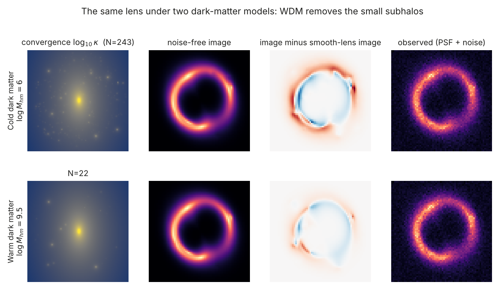
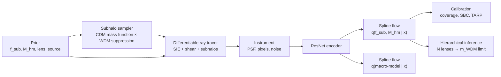
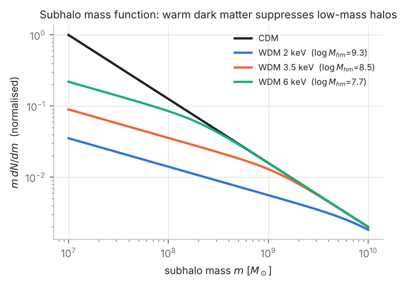
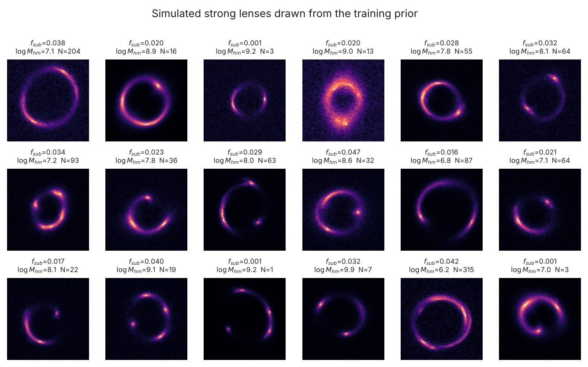
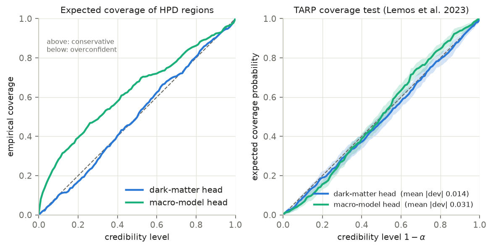
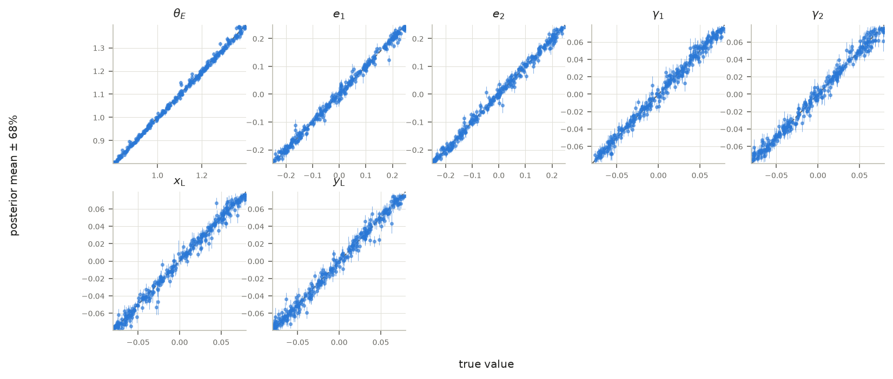
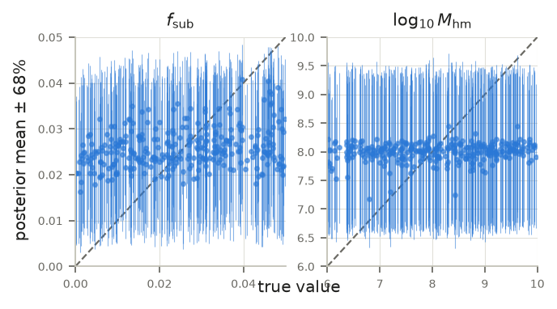
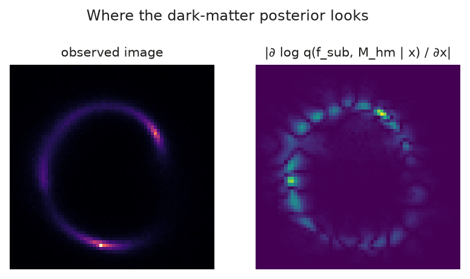
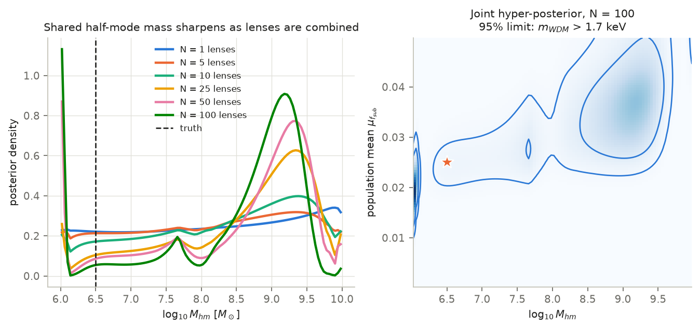

# DarkLens

**Simulation-based inference of dark-matter substructure and warm dark matter from strong gravitational lenses.**

DarkLens uses a deep neural posterior estimator to read the faint gravitational fingerprints of invisible dark-matter clumps in images of strongly lensed galaxies. From a single image it infers calibrated posteriors for the lens galaxy and for two cosmological quantities: the fraction of mass in dark-matter subhalos, and the warm-dark-matter **half-mode mass**, which is set by the mass of the dark-matter particle. A hierarchical step then combines lenses across a mock survey. The results section reports what works and what does not, including where the dark-matter signal is still too weak.

Everything is written from scratch in PyTorch: a differentiable ray-tracing lens simulator, rational-quadratic neural spline flows, a ResNet encoder, posterior calibration tests, and hierarchical population inference. Nothing is downloaded and nothing costs money. The data is simulated on the fly, and the full pipeline runs on a laptop GPU, including the Apple-silicon MPS backend.



---

## Why this matters

Cold dark matter (CDM) predicts that every galaxy is surrounded by thousands of small dark-matter subhalos. If dark matter is instead *warm* (WDM), meaning particles of a few keV that streamed freely in the early universe, then halos below roughly 10⁸–10⁹ M☉ never form. These small halos contain almost no stars, so the only way to find them at cosmological distances is through their **gravity**. A subhalo near the Einstein ring of a strong lens slightly distorts the lensed arcs ([Vegetti et al. 2012](https://arxiv.org/abs/1201.3643)). Counting these distortions statistically measures the small-scale mass function, and so the nature of dark matter ([Gilman et al. 2020](https://arxiv.org/abs/1908.06983); [Vegetti et al. 2024](https://arxiv.org/abs/2306.11781)).

The difficulty is that the likelihood is intractable. Each image depends on hundreds of subhalos with unknown masses and positions, on an unknown source galaxy, and on the main lens. Classical analyses fit these one at a time and take weeks per lens. Upcoming surveys (Euclid, Rubin LSST) will find **tens of thousands** of lenses ([Collett 2015](https://arxiv.org/abs/1507.02657)). **Simulation-based inference** ([Cranmer, Brehmer & Louppe 2020](https://arxiv.org/abs/1911.01429)) avoids the likelihood altogether. A neural network learns the posterior directly from simulations, marginalises over every nuisance parameter implicitly, and amortises the cost, so each new lens takes milliseconds. This is an active research frontier ([Brehmer et al. 2019](https://arxiv.org/abs/1909.02005); [Wagner-Carena et al. 2023](https://arxiv.org/abs/2203.00690); [Anau Montel et al. 2023](https://arxiv.org/abs/2205.09126)), and DarkLens is a self-contained implementation of it.

## What the pipeline does



1. **Simulate** a lens from the prior: draw the dark-matter physics, sample a Poisson realisation of subhalos, ray-trace a source galaxy, and add the telescope's effects.
2. **Train** the network to minimise E[−log q(θ | x)] on an endless stream of fresh simulations. The minimiser of this loss is the true Bayesian posterior.
3. **Validate** that the credible regions are *calibrated*, meaning a 68% region contains the truth 68% of the time.
4. **Combine** many lenses hierarchically to constrain the dark-matter particle mass.

## Physics model

| Component | Model | Reference |
|---|---|---|
| Main deflector | Singular isothermal ellipsoid, analytic deflection | [Kormann et al. 1994](https://ui.adsabs.harvard.edu/abs/1994A%26A...284..285K); [Keeton 2001](https://arxiv.org/abs/astro-ph/0102341) |
| Environment | External shear γ₁, γ₂ | — |
| Subhalos | Tidally truncated isothermal (pseudo-Jaffe) spheres, with a = √(b θ_E) | [Metcalf & Madau 2001](https://arxiv.org/abs/astro-ph/0108224) |
| CDM mass function | dN/dm ∝ m^−1.9 on [10⁷, 10¹⁰] M☉ | [Springel et al. 2008](https://arxiv.org/abs/0809.0898) |
| WDM suppression | n_WDM/n_CDM = [1 + (4.2 M_hm/m)^2.5]^−0.2 | [Lovell 2020](https://arxiv.org/abs/2003.01125) |
| M_hm ↔ m_WDM | Half-mode wavelength of the thermal-relic transfer function | [Viel et al. 2005](https://arxiv.org/abs/astro-ph/0501562); [Schneider et al. 2012](https://arxiv.org/abs/1112.0330) |
| Source | Elliptical Sérsic plus up to two compact star-forming clumps | [Ciotti & Bertin 1999](https://arxiv.org/abs/astro-ph/9911078) for b_n |
| Cosmology | Flat ΛCDM, Planck 2018 (H₀ = 67.4, Ω_m = 0.315), z_l = 0.5, z_s = 2 | [Planck Collaboration 2020](https://arxiv.org/abs/1807.06209) |
| Instrument | 64×64 pixels at 0.065″, 2× supersampling, Gaussian PSF with 0.08″ FWHM, sky plus Poisson noise | HST-WFC3-like |

The lens equation **β = θ − α(θ)** is evaluated on a supersampled grid. The deflections of up to several hundred subhalos per image are summed in a packed, chunked kernel (`simulator.py`), so the cost scales with the actual number of subhalos rather than the padded maximum. Every operation is a PyTorch op, so the simulator is **differentiable** end to end. The tests check this, and `evaluate` uses it to compute saliency maps.

The substructure normalisation is the **CDM-equivalent projected mass fraction** f_sub = M_sub,CDM(<R) / M_main(<R), within R = 2″. WDM then *thins* that population, so f_sub and M_hm are separate physical knobs. Their partial degeneracy (fewer subhalos can mean a lower f_sub or a higher M_hm) is visible in the joint posteriors.



## Machine-learning method

**Neural posterior estimation (NPE)** ([Papamakarios & Murray 2016](https://arxiv.org/abs/1605.06376); [Greenberg et al. 2019](https://arxiv.org/abs/1905.07488)). For a conditional density estimator q_φ(θ | x),

$$\mathcal{L}(\phi)=\mathbb{E}_{\theta\sim p(\theta),\,x\sim p(x\mid\theta)}\left[-\log q_\phi(\theta\mid x)\right]$$

is minimised exactly when q_φ(θ | x) = p(θ | x). No likelihood is ever written down.

* **Encoder.** A ResNet with GroupNorm and GELU (stride-2 stages 32→256 channels). It flattens the final feature map rather than global-pooling it, so the embedding keeps the absolute position information that the lens centre needs.
* **Two flow heads.** `q(f_sub, log M_hm | x)` (2-D, 6 coupling layers) and `q(θ_E, e₁, e₂, γ₁, γ₂, x_L, y_L | x)` (7-D, 8 layers). The dark-matter head is trained only on the dark-matter parameters, so it learns the posterior **already marginalised** over the source, the subhalo positions and masses, the noise, and the macro-model.
* **Rational-quadratic neural spline flows**, implemented from scratch ([Durkan et al. 2019](https://arxiv.org/abs/1906.04032)). These are monotone piecewise rational-quadratic couplings with identity tails, residual-MLP conditioners, and alternating checkerboard and half-split masks. Bin search uses a comparison sum, so it runs on CUDA, MPS and CPU.
* **Bounded priors.** The flows act on z = logit((θ − low)/(high − low)), and densities are mapped back to physical units with the exact Jacobian, so posteriors never leak outside the prior box.
* **Training on the fly.** Every step simulates a fresh batch, so the dataset is infinite and the network cannot overfit to it. Training uses AdamW with warmup and a cosine schedule, plus gradient clipping, and checkpoints are resumable.

**Calibration** (`calibration.py`). A sharp posterior that is wrong is worse than useless ([Hermans et al. 2022](https://arxiv.org/abs/2110.06581)), so DarkLens reports:

* the **expected coverage** of highest-posterior-density regions, computed exactly from the flow density;
* **simulation-based calibration** rank histograms for every parameter ([Talts et al. 2018](https://arxiv.org/abs/1804.06788));
* **TARP** ([Lemos et al. 2023](https://arxiv.org/abs/2302.03026)), a coverage test that is necessary and sufficient for the full joint posterior, with bootstrap bands.

**Hierarchical inference** (`population.py`). The WDM particle mass is the same in every lens, while f_sub varies from lens to lens. With hyper-parameters Λ = (μ_f, log M_hm) and f_i ~ TruncNormal(μ_f, σ_f):

$$p(\Lambda\mid\{x_i\})\;\propto\;p(\Lambda)\prod_i\int\frac{q(f,m\mid x_i)}{\pi(f,m)}\,p(f,m\mid\Lambda)\,df\,dm .$$

This reweights each amortised posterior from the interim training prior π to the population model, following [Wagner-Carena et al. 2021](https://arxiv.org/abs/2010.13787). Because flows give normalised densities, it is evaluated *exactly* on a grid, with no sampling noise. An upper limit on M_hm then becomes a lower limit on the thermal-relic particle mass m_WDM.

## Results

### Simulated data



Each panel is a fresh draw from the training prior. The panels show different Einstein radii, ellipticities and shears, extended and clumpy sources, and between zero and several hundred subhalos.

### Main run (`configs/v2.yaml`): 24,000 steps × 64 ≈ 1.5 M simulations, 5.4 h on an Apple M2

All numbers come from `figures/v2/metrics.json` and `figures/v2/population.json`, computed on 500 fresh test lenses (and two 100-lens mock surveys) that the network never saw. A first run with the original settings is documented under *Training notes*.

| Parameter | Posterior RMSE | Mean 68% width | Contraction vs prior | 68% coverage |
|---|---|---|---|---|
| θ_E (″) | 0.0096 | 0.017 | **0.997** | 0.71 |
| e₁ | 0.012 | 0.023 | 0.992 | 0.75 |
| e₂ | 0.013 | 0.024 | 0.991 | 0.73 |
| γ₁ | 0.0053 | 0.012 | 0.981 | 0.77 |
| γ₂ | 0.0056 | 0.012 | 0.980 | 0.75 |
| x_L (″) | 0.0055 | 0.011 | 0.981 | 0.77 |
| y_L (″) | 0.0057 | 0.011 | 0.981 | 0.75 |
| f_sub | 0.014 | 0.031 | **0.094** | 0.63 |
| log₁₀ M_hm | 1.13 | 2.68 | **0.018** | 0.68 |

*Contraction* is 1 − (posterior variance ÷ prior variance). A value of 1 means the image pins the parameter exactly, and 0 means the image adds nothing to the prior.

**What works.**

* **The macro-model is recovered to about 1% of the Einstein radius**, with 98–99.7% contraction on every parameter. The ellipticity–shear degeneracy is learned without supervision. The macro posteriors are slightly *conservative* (68% intervals cover 71–77% of the truths). That is the safe direction to err in.
* **The dark-matter posteriors are calibrated.** TARP mean deviation is 0.014 for the dark-matter head and 0.031 for the macro head, and the dark-matter HPD coverage curve lies on the diagonal. The model never claims knowledge it does not have.
* **The network attends to the arcs.** The saliency map of the dark-matter posterior is concentrated on the Einstein ring, where subhalos perturb the lensed light, and is near zero elsewhere.

**What does not work yet, stated plainly.**

* **The substructure signal per lens is weak.** The dark-matter head beats the image-blind baseline by 0.053 nats. Each image tightens f_sub by about 9%, and log₁₀ M_hm by under 2%, which is effectively nothing. Its posterior mean for M_hm stays near the prior centre whatever the truth. This is consistent with the literature: per-lens WDM information at HST-like resolution is small, and published constraints come from many lenses, higher resolution, or flux ratios ([Gilman et al. 2020](https://arxiv.org/abs/1908.06983); [Anau Montel et al. 2023](https://arxiv.org/abs/2205.09126)).
* **The population inference is biased, so no particle-mass limit is claimed.** Combining 100 lenses moves the M_hm posterior to about 9.2–9.5 *in both mock surveys*. That happens whether the truth is 6.5 (CDM-like) or 9.0 (WDM), and there is also a spike at the lower prior edge. The per-lens information is tiny, and the product over 100 lenses amplifies small systematic errors in the flow density until they dominate. That is exactly the failure mode the code warns about, and the warning fired on this run (mean per-lens KL ≈ 0.04–0.05 nats). The printed "m_WDM > 1.6–1.7 keV" figures are therefore **not** reported as results.







**What would fix it,** in order of expected impact:

1. **Higher resolution and S/N.** Make the pixels finer (0.03–0.04″) or simulate ELT/JWST-like imaging. Perturbations from 10⁷–10⁸ M☉ subhalos are smaller than the current pixels.
2. **Much longer training, or a dark-matter-only network.** The dark-matter loss was still falling when the learning rate decayed.
3. **Robust population inference.** Use an ensemble of flows or truncated, sequential NPE ([Miller et al. 2021](https://arxiv.org/abs/2107.01214)), and check calibration *at the population level* before trusting a product over lenses.

The earlier pipeline check on a 2-core CPU is kept in `figures/cpu_validation/`.

## Quick start (macOS / Apple silicon, Linux, or Windows)

```bash
cd darklens
python3 -m venv .venv && source .venv/bin/activate
pip install -r requirements.txt
python -m pytest -q
python -m darklens gallery
python -m darklens train --config configs/default.yaml --run runs/default
python -m darklens evaluate --run runs/default
python -m darklens population --run runs/default
```

| Command | What it does |
|---|---|
| `pytest -q` | 20 physics / flow / pipeline tests (~15 s) |
| `gallery` | simulator figures → `figures/` |
| `train` | full run, a few hours on an M2 (`configs/quick.yaml` for a ~20–30 min smoke run) |
| `evaluate` | calibration, recovery, example posteriors, saliency |
| `population` | mock survey → m_WDM limit |

The device is chosen automatically (CUDA → MPS → CPU). You can override it with `--device mps`. Training prints its throughput and ETA, writes `train_log.csv`, and can be stopped and resumed with `--resume`. `--max-minutes 90` stops cleanly after a time budget. If an op is missing on an older PyTorch MPS build, run with `PYTORCH_ENABLE_MPS_FALLBACK=1`.

## Training notes

**How to read the log.** The `dm` and `macro` numbers are negative log-densities in logit space. A head that ignores the image and just predicts the prior cannot score below a fixed **prior-only baseline**. This is about 4.01 for the 2-D dark-matter head with the default spline tail bound of 10, and 4.33 with the bound of 5 used before v0.2. The training log prints each head's distance from that baseline. A head has only learned something from the images once it sits clearly *below* it.

**Run 1, a lesson worth keeping.** The first full run (`configs/default.yaml`, tail bound 5) learned the macro-model well. After about 11,000 steps (≈ 0.7 M simulations), however, the dark-matter head plateaued at 4.35, right at its prior-only floor of 4.33. The early drop from 4.43 to 4.35 came from the flow learning the *shape of the prior*, not from reading the images. Two changes followed:

* **The flow's tail bound went from 5 to 10.** Uniform priors become logistic distributions in logit space, which have exponential tails. With the bound at 5, 1.3% of prior mass fell into the Gaussian tails, which added 0.33 nats of irreducible loss and hid the real signal.
* **`configs/v2.yaml` makes the substructure signal easier to learn.** It removes the source clumps, which mimic subhalo perturbations. It makes the arcs brighter, as in deeper imaging, for about 2.5× the S/N. It also weights the dark-matter loss 3× in the shared encoder. Each head is still minimised by its own true posterior, so the weight changes what the encoder prioritises, not the target.

## Repository layout

```
darklens/
  cosmology.py     flat ΛCDM distances, critical surface density
  profiles.py      SIE, shear, pseudo-Jaffe, Sérsic, PSF (all differentiable)
  substructure.py  subhalo mass function, WDM suppression, M_hm ↔ m_WDM
  simulator.py     batched lens simulator (priors → images)
  priors.py        box-uniform priors with exact logit bijection
  flows.py         rational-quadratic spline coupling flows (from scratch)
  model.py         ResNet encoder + two posterior heads
  train.py         on-the-fly NPE training loop
  calibration.py   HPD coverage, SBC ranks, TARP, recovery metrics
  population.py    hierarchical inference and WDM limits
  plotting.py      all figures (no extra plotting dependencies)
  cli.py           `python -m darklens {gallery,train,evaluate,population}`
configs/           default.yaml, v2.yaml, quick.yaml, cpu_ci.yaml
tests/             Poisson-equation, mass, sampler, flow-invertibility, normalisation, pipeline tests
figures/           generated figures
```

## How correctness is tested

The physics is verified against identities rather than against itself:

* **Poisson equation.** For every mass profile, the finite-difference ∇·α equals 2κ (the analytic convergence), and ∇×α = 0.
* **Subhalo mass.** π b a Σ_cr reproduces each subhalo's mass, and the deflection at large radius gives the right total mass.
* **Sampling.** The Poisson subhalo counts and power-law mean masses match their analytic expectations.
* **Particle mass.** The m_WDM ↔ M_hm conversion reproduces the published correspondence 5.2 keV ↔ 10^7.8 M☉ (Gilman et al. 2020).
* **Flows.** The spline log-determinant matches autograd, the inverse round-trips, and the flow density integrates to 1 on a grid.
* **Priors.** The prior bijection's Jacobian matches autograd.
* **Simulator.** Gradients flow from pixels to the lens parameters.

## Prior work and attribution

**The idea is not new, and this repository does not claim it is.** Neural inference of subhalo populations from strong-lens images was developed by [Brehmer et al. (2019)](https://arxiv.org/abs/1909.02005), [Wagner-Carena et al. (2021](https://arxiv.org/abs/2010.13787), [2023)](https://arxiv.org/abs/2203.00690) and [Anau Montel et al. (2023)](https://arxiv.org/abs/2205.09126), among others. DarkLens is an independent, from-scratch implementation of that approach, written to learn and demonstrate the method end to end. Every physical formula and statistical test is taken from the paper cited next to it in the tables above and in the code docstrings.

**No code was copied from other projects.** The parts that most closely follow a published reference are:

* **`flows.py`**, the rational-quadratic spline. It implements the equations of [Durkan et al. (2019)](https://arxiv.org/abs/1906.04032) and follows the conventions of the authors' reference library [`nflows`](https://github.com/bayesiains/nflows) (MIT licence): minimum bin widths and heights, and boundary derivatives fixed to 1 to join the identity tails.
* **`calibration.py`**, the TARP test. It implements the algorithm of [Lemos et al. (2023)](https://arxiv.org/abs/2302.03026).
* **`population.py`**, the hierarchical reweighting. It follows the formulation of [Wagner-Carena et al. (2021)](https://arxiv.org/abs/2010.13787).

**Related open-source tools.** These are established, more complete packages for the same kind of work: [`lenstronomy`](https://github.com/lenstronomy/lenstronomy) (lens modelling), [`paltas`](https://github.com/swagnercarena/paltas) (substructure simulation and inference), [`caustics`](https://github.com/Ciela-Institute/caustics) (differentiable lensing in PyTorch), [`swyft`](https://github.com/undark-lab/swyft) (truncated marginal neural ratio estimation) and [`sbi`](https://github.com/sbi-dev/sbi) (simulation-based inference). DarkLens deliberately depends on none of them, so that every component is visible and tested in this repository.

## Limitations and next steps

This is a research-grade pipeline on simulated data, and its scope is deliberately stated:

* **Simulated data only.** Applying it to real HST, JWST or Euclid lenses would also require modelling the lens galaxy's light, realistic PSFs and noise, and data-driven source priors.
* **No line-of-sight halos.** Halos along the line of sight carry much of the real signal ([Despali et al. 2018](https://arxiv.org/abs/1710.05029)). They are the next ingredient to add, and they slot into `deflection()` with multi-plane ray tracing.
* **Simple subhalo profile.** Pseudo-Jaffe subhalos are a standard simplification. Truncated NFW profiles with a WDM mass–concentration relation would make the inference more sensitive.
* **Fixed redshifts.** A single (z_l, z_s) pair; sampling the redshifts would generalise it.
* **Hierarchical products amplify estimator error.** Multiplying many posterior ratios can turn small miscalibration into bias. That is why the calibration tests come first, and why ensembles or sequential and truncated NPE ([Miller et al. 2021](https://arxiv.org/abs/2107.01214)) are natural extensions.

## References

Anau Montel, N., Coogan, A., Correa, C., Karchev, K. & Weniger, C. (2023). Estimating the warm dark matter mass from strong lensing images with truncated marginal neural ratio estimation. *MNRAS* 518, 2746. [arXiv:2205.09126](https://arxiv.org/abs/2205.09126)
Brehmer, J., Mishra-Sharma, S., Hermans, J., Louppe, G. & Cranmer, K. (2019). Mining for dark matter substructure. *ApJ* 886, 49.
Collett, T. (2015). The population of galaxy–galaxy strong lenses in forthcoming optical imaging surveys. *ApJ* 811, 20.
Cranmer, K., Brehmer, J. & Louppe, G. (2020). The frontier of simulation-based inference. *PNAS* 117, 30055.
Durkan, C., Bekasov, A., Murray, I. & Papamakarios, G. (2019). Neural spline flows. *NeurIPS*.
Gilman, D. et al. (2020). Warm dark matter chills out. *MNRAS* 491, 6077.
Hermans, J. et al. (2022). A trust crisis in simulation-based inference? *TMLR*.
Keeton, C. (2001). A catalog of mass models for gravitational lensing. arXiv:astro-ph/0102341.
Lemos, P., Coogan, A., Hezaveh, Y. & Perreault-Levasseur, L. (2023). Sampling-based accuracy testing of posterior estimators for general inference. *ICML*.
Lovell, M. (2020). Toward a general parameterization of the warm dark matter halo mass function. *ApJ* 897, 147.
Metcalf, R. B. & Madau, P. (2001). Compound gravitational lensing as a probe of dark matter substructure within galaxy halos. *ApJ* 563, 9.
Papamakarios, G. & Murray, I. (2016). Fast ε-free inference of simulation models with Bayesian conditional density estimation. *NeurIPS*.
Planck Collaboration (2020). Planck 2018 results. VI. Cosmological parameters. *A&A* 641, A6.
Schneider, A., Smith, R. E., Macciò, A. V. & Moore, B. (2012). Non-linear evolution of cosmological structures in warm dark matter models. *MNRAS* 424, 684.
Talts, S. et al. (2018). Validating Bayesian inference algorithms with simulation-based calibration. arXiv:1804.06788.
Vegetti, S. et al. (2012). Gravitational detection of a low-mass dark satellite galaxy at cosmological distance. *Nature* 481, 341.
Vegetti, S. et al. (2024). Strong gravitational lensing as a probe of dark matter. *Space Science Reviews* 220, 58.
Wagner-Carena, S. et al. (2021). Hierarchical inference with Bayesian neural networks: an application to strong gravitational lensing. *ApJ* 909, 187.
Wagner-Carena, S. et al. (2023). From images to dark matter: end-to-end inference of substructure from hundreds of strong gravitational lenses. *ApJ* 942, 75.

## License

MIT © 2026 Ram Uthayakumaar
